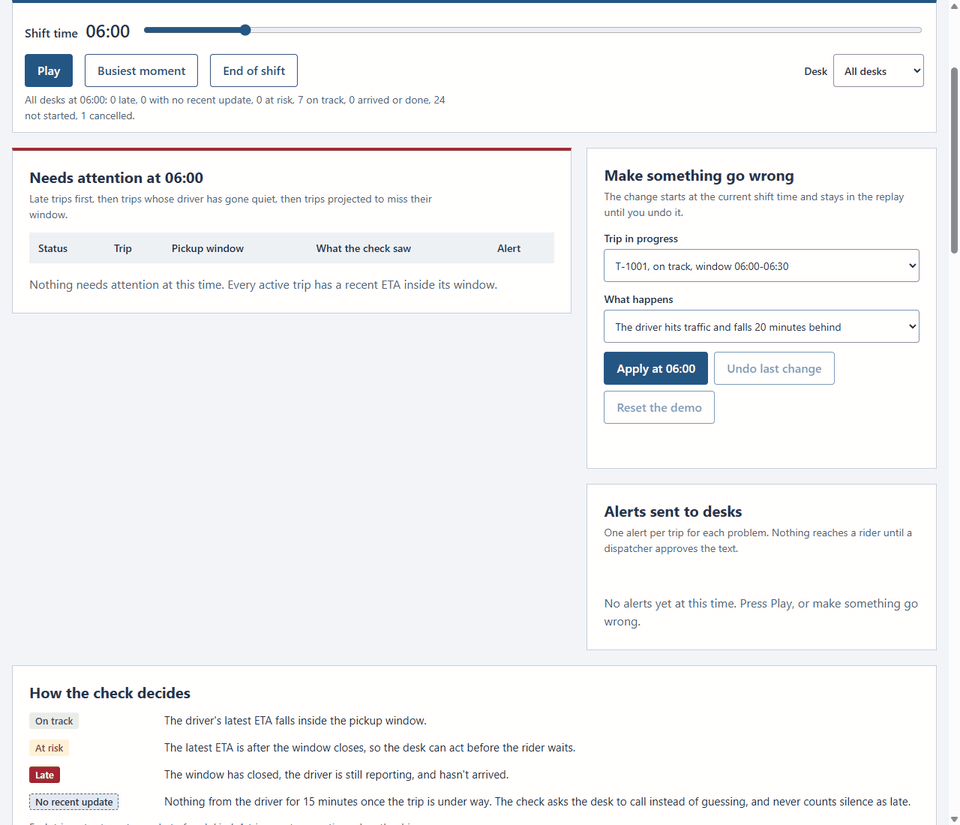
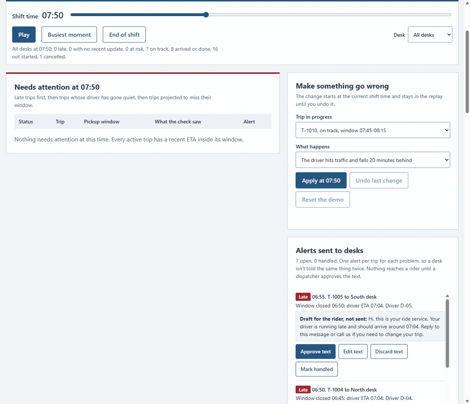
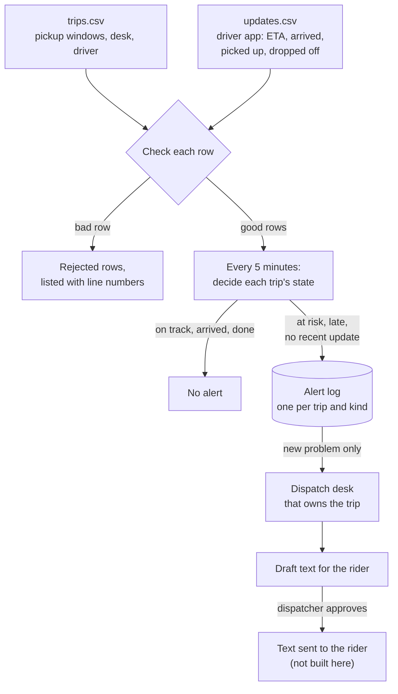
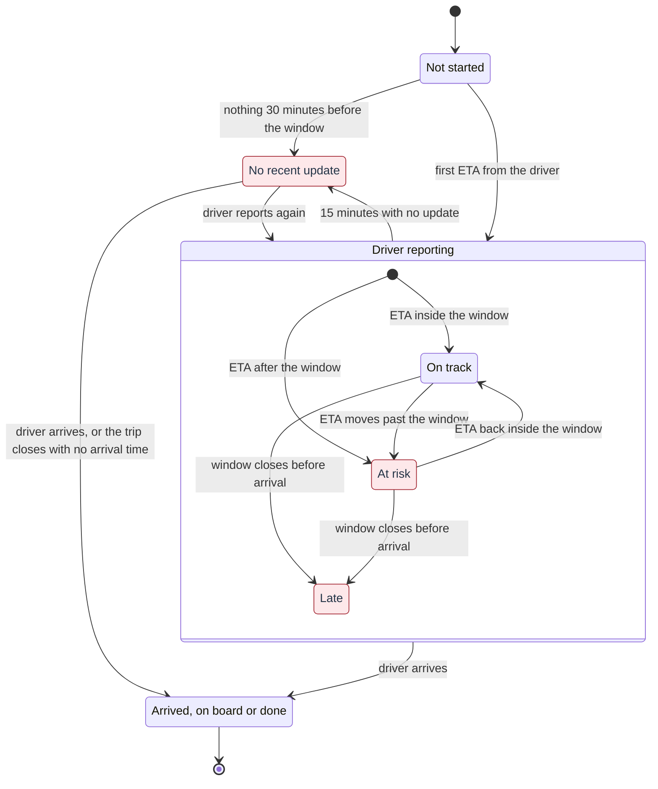
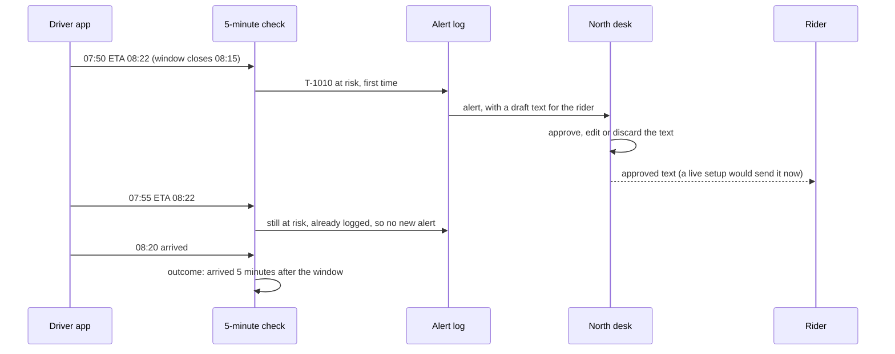

# Late-trip monitor

A check for medical-transport dispatch that runs every 5 minutes. It compares each driver's latest ETA with the rider's pickup window and alerts the dispatch desk that owns the trip when a pickup is at risk, late, or the driver has gone quiet. It drafts a text for the rider, and nothing is sent until a dispatcher approves it.

**Try it:** [derpynewb.github.io/late-trip-monitor](https://derpynewb.github.io/late-trip-monitor/). It runs in the browser, so there's nothing to install and no sign-in.

**Status:** a reference build with made-up data. Every rider, driver, zone and desk is fictional. It isn't connected to a dispatch system and sends no messages.



## What it's for

Riders booked for non-emergency medical trips, such as dialysis, clinic visits or a ride home from hospital, are given a pickup window, here 30 minutes. A dispatcher may be watching dozens of trips at once, and a late pickup can mean a missed appointment. Most trips go to plan, so the useful thing is a short list of the few that need a person now, ideally before the window closes.

The monitor reads two things a dispatch system already has: the trip schedule and the updates from the driver app (ETA, arrived, picked up, dropped off). Every 5 minutes it decides each trip's state and sends a new problem to the desk that owns the trip. It's designed around three rules:

- **Warn early.** A trip is flagged as soon as the driver's ETA falls after the window closes, while there is still time to act.
- **Don't guess.** If the driver app goes quiet, the trip is marked "No recent update" and the desk is asked to call. Silence is never reported as late.
- **A person decides what reaches a rider.** The text for the rider is a draft. A dispatcher approves, edits or discards it.

## Try the demo

1. Press **Play**, or drag the shift time. "Busiest moment" jumps to the time when the most trips need attention.
2. Under **Make something go wrong**, pick a trip in progress and delay its driver by 20 minutes, silence their app for 25 minutes, or cancel the ride. The change starts at the current shift time, and you can undo it or reset the demo.
3. In **Alerts sent to desks**, approve, edit or discard the text drafted for the rider, and mark the alert handled.
4. Choose a desk to see only that desk's trips and alerts.
5. Under **Try your own files**, load two CSV files shaped like the samples (the page links both as templates). They're read in your browser and never uploaded. Please use made-up data.



## How it works



A bad row, such as an unknown trip, a driver who isn't assigned to it, a status the check doesn't know or a missing ETA, is listed with its line number and skipped. The rest of the file still loads.

The alert log allows one alert per trip for each kind of problem. In the Python version a database primary key enforces this, so a re-run or two overlapping runs can't alert a desk twice about the same thing.

## How the check decides



The shaded states send an alert.

| State | Rule |
| --- | --- |
| On track | The driver's latest ETA falls inside the pickup window. |
| At risk | The latest ETA is after the window closes. The desk gets one alert and a draft text for the rider. |
| Late | The window has closed, and the driver is still reporting but hasn't arrived. The desk gets one alert and a draft text. |
| No recent update | Nothing from the driver for 15 minutes once the trip is under way, which starts 30 minutes before the window opens. The desk is asked to call. |

- A trip counts as on time when the driver arrives inside the window, not when the rider gets in.
- If the first sign of the driver comes after the window, such as a pickup with no arrival update, the arrival time is reported as not recorded instead of being guessed.
- The thresholds are constants at the top of `monitor.py` and `docs/engine.js`: 15 minutes before a trip counts as quiet, 30 minutes of lead time and a 5-minute check.

## One alert, start to finish

This is T-1010 from the second GIF, after its driver is delayed at 07:50.



## What the sample shift shows

32 trips on one morning, with eight drivers covering three desks. Most go to plan. The rest cover each case the check has to handle: drivers who recover after an at-risk alert, late arrivals with and without an early warning, drivers who go quiet and come back, one who never reports an arrival, no-shows, a cancellation, and five deliberately bad rows.

The end-of-shift results report how the alerts did as well as the on-time rate:

- 87% of trips with a recorded arrival were on time (26 of 30).
- 3 of the 4 late arrivals were flagged at risk first, 25 minutes before the window closed on average.
- 1 late arrival was only reported after its window had closed, so no early warning was possible.
- 2 at-risk alerts were for trips that still arrived on time.

The last three are the numbers to watch when tuning the thresholds: warnings that came early enough, problems the check missed, and alerts that turned out not to be needed.

## Run it locally

Python 3.11 or later, with no packages to install. Node.js is only needed for the test that compares the two versions.

```powershell
python -m unittest -v                              # 11 tests
python monitor.py check --at "2026-11-10 07:00"    # what the 5-minute job alerts at 07:00
python monitor.py check --at "2026-11-10 07:00"    # same time again: no repeated alerts
python monitor.py report                           # end-of-shift results for the whole sample
```

To see the dashboard, open `docs/index.html` in a browser; it works straight from disk. `python make_sample.py` rewrites the sample files and `docs/data.js`. It uses a fixed seed, so the output doesn't change.

## Two versions of the same rules

The rules exist twice, on purpose. `monitor.py` is the scheduled job: it would run every 5 minutes next to a dispatch system and keep its alert log in SQLite. `docs/engine.js` runs the same rules in the browser, so the demo can react to changes and to your own files without a server. A test runs both on the sample shift and checks that every state change, alert, rejected row and result matches, so the two can't drift apart unnoticed.

## Files

| File | What it does |
| --- | --- |
| `monitor.py` | The scheduled job: loads and checks the CSV files, decides each trip's state, records alerts, and prints the end-of-shift report |
| `docs/engine.js` | The same rules for the browser |
| `docs/index.html`, `docs/app.js`, `docs/style.css` | The demo page: replay, changes, alert handling and loading your own files |
| `docs/data.js` | The sample files, embedded so the page works without a server |
| `make_sample.py` | Writes the fictional shift to `samples/` and `docs/data.js` |
| `samples/trips.csv`, `samples/updates.csv` | Trips with their pickup windows, and the driver app updates |
| `test_monitor.py` | Rules, one alert per trip and kind across runs, rejected rows, the sample results, and the Python and browser versions agreeing |

## Not covered

- Times are local and cover one shift. A real system would need time zones for shifts that cross midnight or a daylight-saving change.
- The driver app's ETA is taken as given. The check doesn't estimate travel time itself.
- Alerts are written to a log. Sending them to a desk (by chat, SMS or a dispatch screen) and sending approved texts to riders are the next steps, and both depend on the systems a team already uses.
- There's no reassignment: a trip keeps the driver it was planned with.
- In the demo, your alert handling and changes last until you reload the page.
