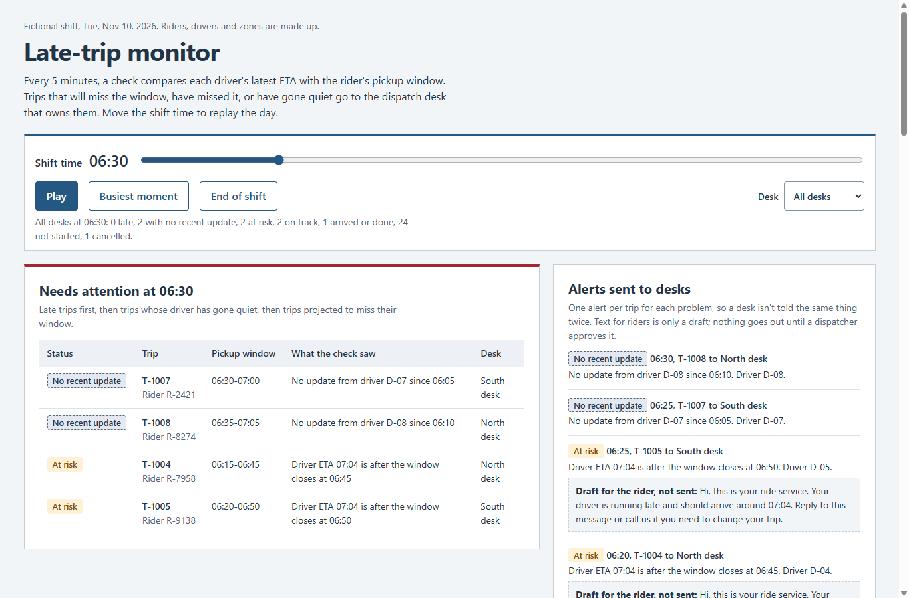

# Late-trip monitor

A check that runs every 5 minutes during a medical-transport shift. It compares each driver's latest ETA with the rider's pickup window and alerts the dispatch desk that owns the trip when the pickup is at risk, late, or the driver has gone quiet. A static dashboard replays a whole shift.

**Status:** reference build with made-up data. Every rider, driver, zone and desk is fictional. It isn't connected to a dispatch system, and it sends no messages: alerts go to a local log, and text for riders is only a draft.

**Dashboard:** [derpynewb.github.io/late-trip-monitor](https://derpynewb.github.io/late-trip-monitor/)



## Run it

Python 3.11 or later, no packages to install.

```powershell
python -m unittest -v                                # 9 tests
python monitor.py check --at "2026-11-10 07:00"      # what the 5-minute job would alert at 07:00
python monitor.py check --at "2026-11-10 07:00"      # same time again: no repeated alerts
python monitor.py build                              # replay the shift and write docs/data.js
```

Open `docs/index.html` in a browser to see the dashboard. `python make_sample.py` rewrites the sample files; it uses a fixed seed, so the output doesn't change.

## How the check decides

| State | Rule |
| --- | --- |
| On track | The driver's latest ETA falls inside the pickup window. |
| At risk | The latest ETA is after the window closes. The desk gets one alert and a draft text for the rider. |
| Late | The window has closed, and the driver is still reporting but hasn't arrived. |
| No recent update | Nothing from the driver for 15 minutes once the trip is under way (30 minutes before the window opens). The desk is asked to call; silence is never counted as late. |

- A trip counts as on time when the driver arrives inside the window, not when the rider gets in. If the first sign of the driver comes after the window, such as a pickup with no arrival update, the arrival time is reported as not recorded instead of being guessed.
- Each trip gets at most one alert of each kind. The SQLite primary key enforces this, so a re-run or an overlapping run can't repeat an alert.
- A bad row in either file (an unknown trip, a driver who isn't assigned to it, an unknown status, a missing ETA or time) is listed with its line number and skipped. The rest of the file still loads.
- The thresholds are constants at the top of `monitor.py`: `STALE`, `LEAD` and `STEP`.

## What the sample shift shows

32 trips on one morning, with eight drivers covering three desks. Most go to plan. The rest cover each case the check has to handle: drivers who recover after an at-risk alert, late arrivals with and without an early warning, drivers who go quiet and come back, one who never reports an arrival, no-shows, a cancellation and five deliberately bad rows. The end-of-shift results report how the alerts did as well as the on-time rate: late arrivals that were flagged in advance and how far ahead, late arrivals with no warning, and at-risk alerts for trips that still arrived on time.

## Files

| File | What it does |
| --- | --- |
| `monitor.py` | Loads and checks the CSV files, decides each trip's state, records alerts, and builds the dashboard data |
| `make_sample.py` | Writes the fictional shift to `samples/` |
| `samples/trips.csv`, `samples/updates.csv` | Trips with their pickup windows, and the driver app updates |
| `test_monitor.py` | Rules, alert de-duplication across runs, rejected rows, and a check that `docs/data.js` matches the samples |
| `docs/` | The static dashboard (HTML, CSS, JavaScript and the generated `data.js`) |

## Not covered

- Times are local and cover one day. A real shift that crosses midnight or a daylight-saving change would need time zones.
- The driver app's ETA is taken as given. The check doesn't estimate travel time itself.
- Alerts are written to a local log. Sending them to a desk (by chat, SMS or a dispatch screen) and approving the rider text are the next steps, and both depend on the systems a team already uses.
- There's no reassignment: a trip keeps the driver it was planned with.
